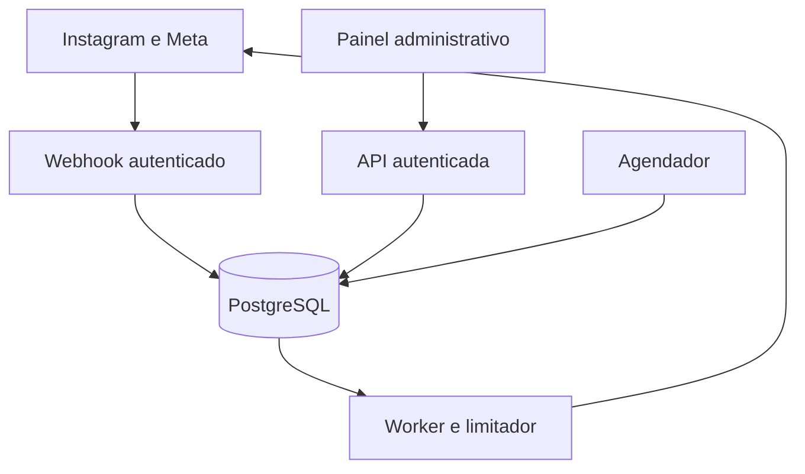

# 04 — Arquitetura e decisões técnicas

> Atualização de escopo (16/10/2026): configuração por variáveis e gestão de múltiplas contas fazem parte do MVP. Consulte [a diretriz vigente](../docs/15-CONFIGURACAO-E-MULTIPLAS-CONTAS.md), que prevalece sobre referências anteriores a conta única. Implementação e contratos executáveis ainda pendentes.

## Stack proposta

Frontend React/TypeScript; API FastAPI; worker Python separado; PostgreSQL como fonte de verdade e fila persistente; proxy HTTPS; armazenamento de backups privado. Não adicionar Redis no MVP. Não usar processo infinito dentro de requisição serverless. Se painel estiver na Vercel, API/worker permanecem em ambiente que suporte processo contínuo. Hospedagem é decisão pendente, não contratação feita.

## Componentes

API e worker compartilham código de domínio, mas podem reiniciar independentemente. Provedor Meta isolado em adaptador; política de campanha não faz chamadas HTTP diretamente.

## Recebimento

Preservar corpo bruto → validar HMAC → interpretar lote → inserir envelope e eventos normalizados na mesma transação → commit → responder 200. Se banco falhar, responder 503 para permitir nova entrega. Assinatura inválida retorna 401/403. Limitar tamanho a 1 MiB inicialmente e observar compatibilidade real; não truncar silenciosamente. Evento autenticado desconhecido pode ser persistido com motivo unsupported e receber 200.

Chave de evento: ID de evento estável quando disponível; caso contrário hash canônico de conta, tipo, comment_id e dados relevantes. Hash do envelope sozinho não resolve eventos repetidos em lotes diferentes. Duplicidade semântica final protegida por UNIQUE(account_id, comment_id) no envio.

## Concorrência e entrega

Worker seleciona jobs com FOR UPDATE SKIP LOCKED e lease. Reserva envio e slot de limite em transação curta. Antes do despacho, verifica pausa, versão, expiração e conexão novamente; serializa decisão por conta/estado para que pausa confirmada impeça novos despachos. Não manter transação aberta esperando Meta.

Persistir attempt_id e sending antes do request. Request com connect/read timeout; persistir resposta sanitizada, message_id e trace externo. Reinício entre aceite externo e gravação local resulta em unknown. Nenhum mecanismo local garante exactly-once na fronteira externa; preferência é não duplicar, mesmo podendo perder um envio nesse caso.

## Estrutura de repositório a criar

- apps/web: páginas e cliente do backend.
- apps/api: rotas, autenticação, webhook e administração.
- apps/worker: processamento, scheduler e retenção.
- packages/domain: regras puras, estados e motivos.
- packages/meta: adapter, transporte e classificação de erros.
- db/migrations: schema e dados de bootstrap não secretos.
- tests: unitários, integração, contrato e concorrência.
- infra: Dockerfiles, Compose, proxy e scripts de backup.
- docs e spec: este pacote.

## Decisões arquiteturais iniciais

ADR01 Instagram Login apenas; evita misturar hosts, tokens e scopes. ADR02 fila PostgreSQL; menos serviços e transação com dados. ADR03 unknown sem reenvio automático; prioriza não duplicar. ADR04 link direto ao produto; sem redirecionador/rastreamento no MVP. ADR05 multiempresa adiado; organization_id desde o início reduz migração futura, mas não é prova de isolamento.

Backfill P1: buscar comentários paginados por cursor, aplicar activated_at e as mesmas regras. Não presumir filtros de tempo aceitos pelo endpoint. Descoberta de comentários antigos não renova janela.
