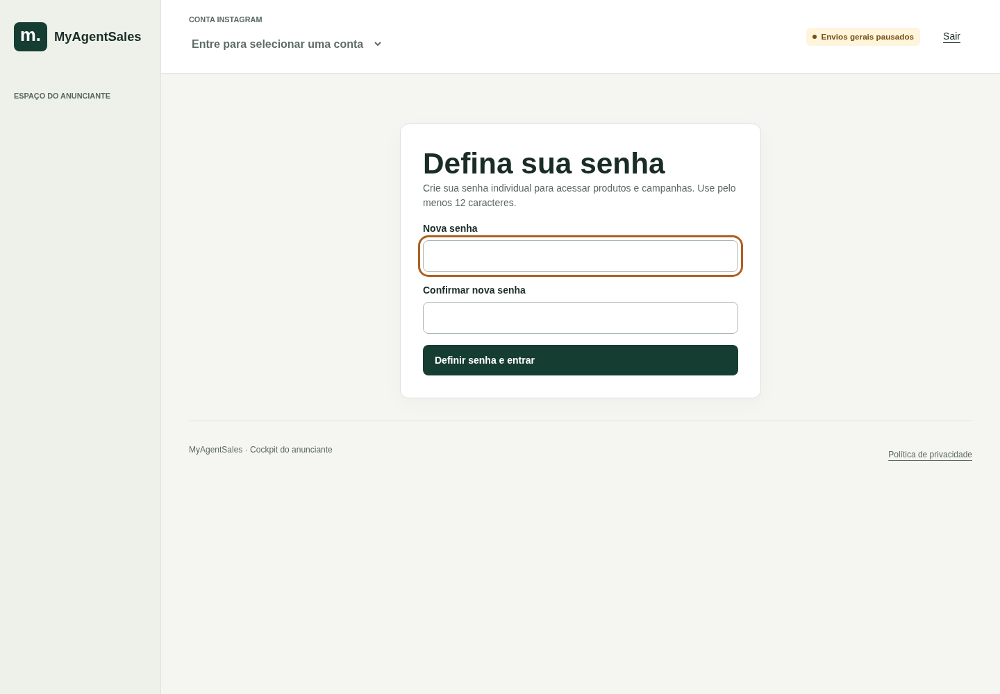
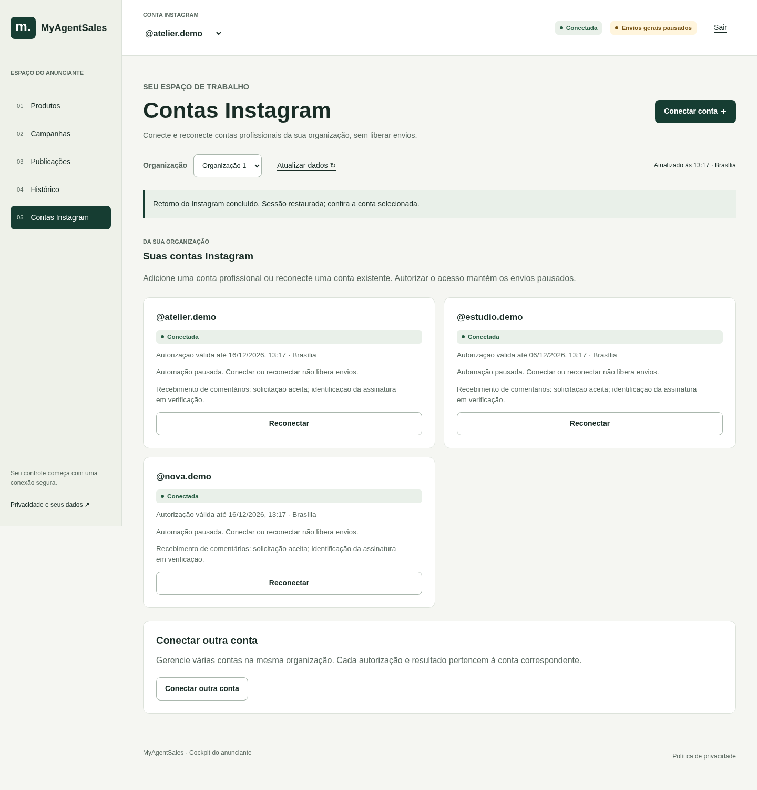
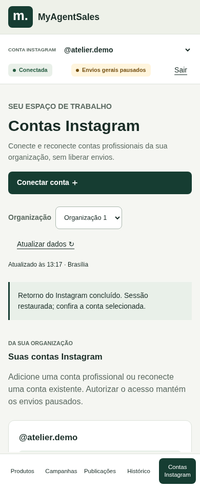
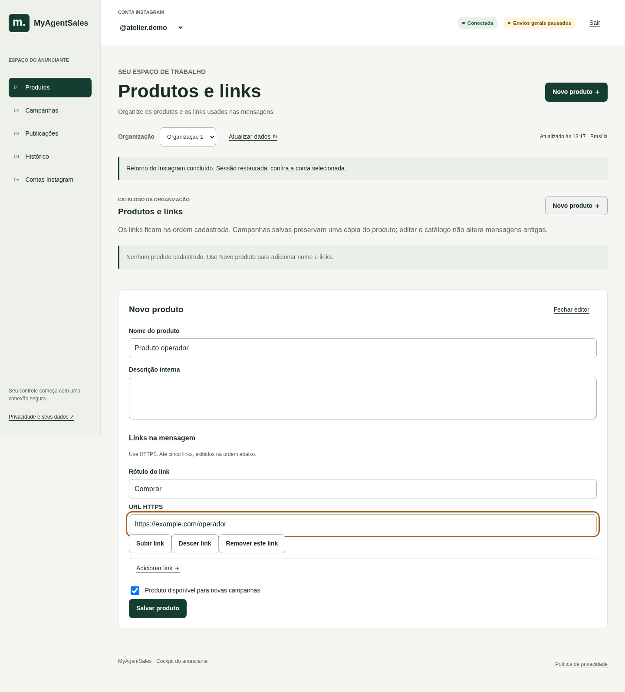
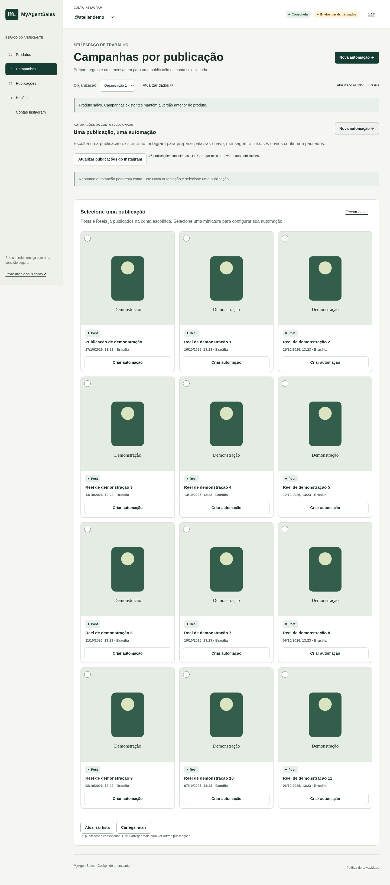
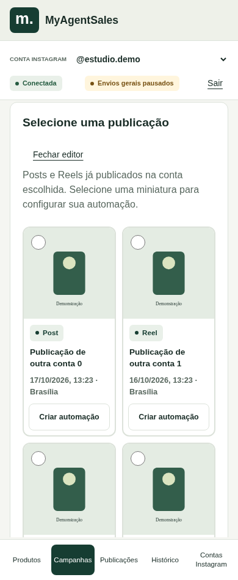
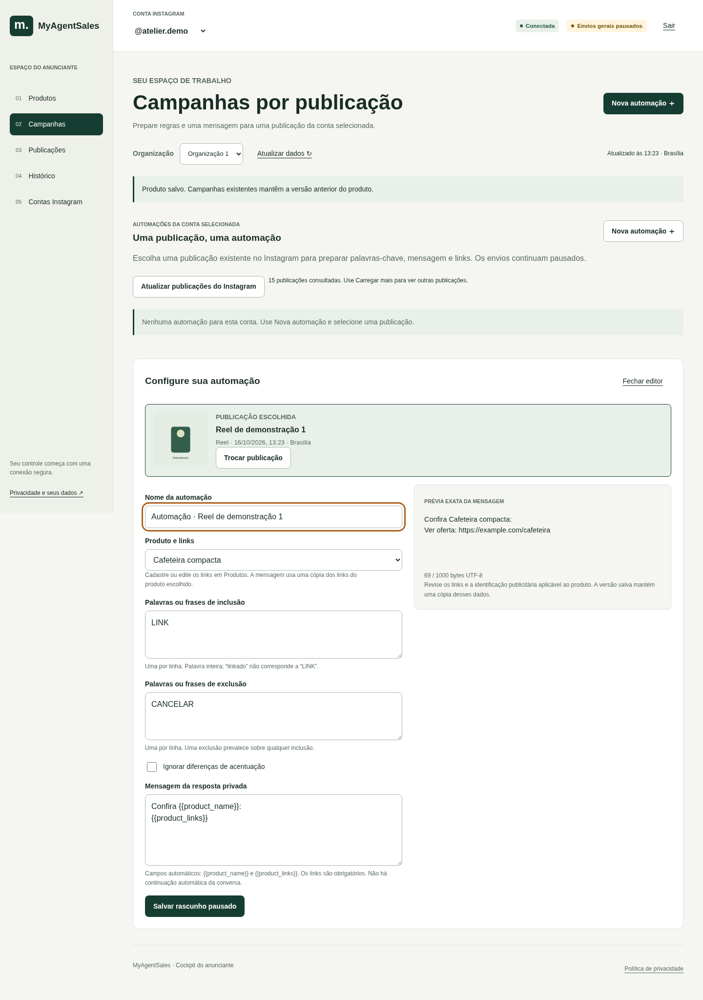
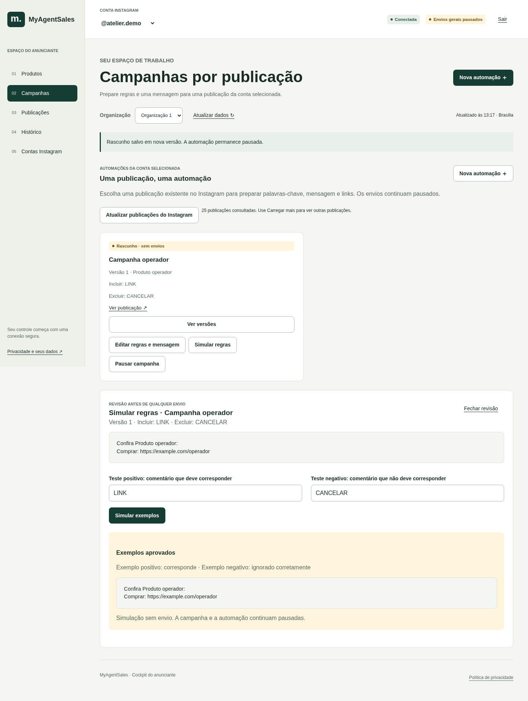
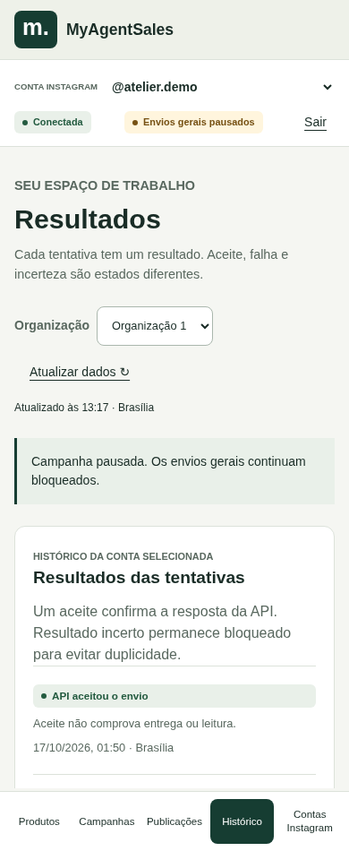

# Manual do Operador — MyAgentSales

Atualizado em 17/10/2026. Este guia explica as funções disponíveis para o perfil **Operador**.

**Você já pode preparar produtos, links e campanhas. Os envios gerais continuam pausados. Salvar ou simular uma campanha não envia mensagens.**

As imagens mostram a aplicação real com uma conta e produtos fictícios, apenas para demonstração. Nenhum cadastro ou comentário de cliente foi usado nas capturas.

## 1. Primeiro acesso

Abra o [cockpit do MyAgentSales](https://raises-formula-parameter-muslim.trycloudflare.com/m0/connect).

Seu acesso já foi cadastrado: entre com **seu próprio e-mail e sua própria senha** e selecione **Entrar no cockpit**. Não use a conta de outra pessoa.

Para quem receber um convite de primeiro acesso, o link abre **Defina sua senha**. Preencha **Nova senha** e **Confirmar nova senha**, com pelo menos 12 caracteres, e escolha **Definir senha e entrar**. Se você já tem senha, use o login normal.



Se não lembrar a senha ou o convite estiver vencido, peça ajuda ao administrador. **Ainda não há botão “Esqueci minha senha” no cockpit.** Não envie sua senha por mensagem.

O endereço atual é temporário. Se deixar de abrir, solicite ao administrador o endereço atualizado.

## 2. Confira a conta antes de trabalhar

No alto da tela, confira **CONTA INSTAGRAM** e o nome que começa com `@`. Se houver mais de uma conta disponível, use esse seletor para escolher a desejada.

| O que aparece | O que significa para você |
|---|---|
| **Conectada** | A conta tem uma conexão registrada. Isso não libera mensagens. |
| **Envios gerais pausados** | As campanhas não estão liberadas para enviar. Você pode continuar preparando o conteúdo. |
| Aviso de autorização expirada ou reconexão necessária | Abra **Contas Instagram** e use **Reconectar**. Se o aviso continuar, peça ajuda ao administrador. |

Você tem cinco menus: **Produtos**, **Campanhas**, **Publicações**, **Histórico** e **Contas Instagram**. No celular eles ficam na parte inferior; a conta selecionada continua no cabeçalho e o conteúdo rola dentro da tela.

**Produtos são compartilhados dentro da organização. Publicações, campanhas e resultados acompanham a conta Instagram selecionada.** Trocar a conta não cria uma cópia do catálogo de produtos.

## Conecte ou reconecte uma conta Instagram

Em **Contas Instagram**, você pode adicionar contas profissionais ou renovar o acesso de uma conta existente na sua organização. A tela mostra os nomes, a situação da conexão, a validade da autorização e a pausa. Você não precisa preencher configurações técnicas.

### Adicionar uma conta

1. Abra **Contas Instagram** e escolha **Conectar conta ＋** ou **Conectar outra conta**.
2. Você será levada ao Instagram para autorizar o acesso. Use uma conta profissional que você tenha permissão para gerenciar e confira qual conta está sendo autorizada.
3. Revise e conceda as permissões solicitadas pelo Instagram.
4. Ao voltar ao cockpit, confira se a conta aparece em **Suas contas Instagram**. No seletor do cabeçalho, escolha a conta com a qual deseja trabalhar.



Se não houver nenhuma conta, a tela orienta usar **Conectar conta**. Concluir a autorização cadastra a conta na organização em que você iniciou a conexão. **Adicionar uma conta não ativa campanhas nem libera envios.**

### Reconectar uma conta existente

1. Em **Contas Instagram**, localize o nome `@` correto.
2. Escolha **Reconectar** no cartão dessa conta.
3. No Instagram, autorize **a mesma conta**. Se você escolher outra, a reconexão será recusada para proteger o vínculo existente.
4. Ao retornar, confira a situação da conexão. As campanhas e o histórico da conta são preservados e os envios continuam pausados.



O aviso **solicitação aceita; identificação da assinatura em verificação** se refere ao recebimento de comentários. Ele não significa mensagem enviada nem conta desconectada. Você pode preparar produtos e campanhas enquanto o administrador verifica essa pendência.

Se o Instagram recusar a autorização, cancele e peça ajuda ao administrador, informando o aviso exibido. Não tente substituir uma conta existente por outra pela ação **Reconectar**; para outra conta, use **Conectar conta**. Nem toda conta consegue autorizar o acesso nesta fase: isso também depende das permissões e da liberação da aplicação no Instagram.

## 3. Cadastre produtos e links

1. Entre em **Produtos** e escolha **Novo produto ＋**.
2. Preencha **Nome do produto**. Exemplo: `Cafeteira compacta`.
3. Se precisar, use **Descrição interna** para uma anotação de trabalho. Essa descrição não entra automaticamente na mensagem.
4. Em **Links na mensagem**, preencha **Rótulo do link** e **URL HTTPS**.
5. Mantenha **Produto disponível para novas campanhas** marcado e escolha **Salvar produto**.

Exemplo fictício:

| Campo | Exemplo |
|---|---|
| Nome do produto | Cafeteira compacta |
| Descrição interna | Conferir preço antes de preparar a campanha |
| Rótulo do link | Ver oferta |
| URL HTTPS | `https://example.com/cafeteira` |

O endereço do exemplo é só demonstrativo: substitua pelo link real do produto. Abra e confira o destino antes de usar.

**A busca e a descoberta automática de produtos Shopee ainda não estão disponíveis.** Até o Administrador validar a API oficial, cadastre manualmente apenas produtos e links de afiliado obtidos e conferidos pela organização. Não use URL comum como se fosse link de afiliado; não há dados reais de popularidade ou comissão exibidos pelo cockpit neste momento.



Você pode cadastrar **de um a cinco links** por produto. Use **Adicionar link ＋** para incluir outro e **Subir link**, **Descer link** ou **Remover este link** para organizar. A mensagem usa a ordem dos links cadastrados.

Para corrigir um produto, escolha **Editar produto** e salve. Para tirá-lo das opções de novas campanhas, escolha **Inativar produto** e confirme. Isso não apaga seu histórico. É possível voltar ao editor e marcar novamente a disponibilidade.

**Editar ou inativar um produto não atualiza automaticamente as mensagens das campanhas já salvas.** Elas guardam uma cópia do produto e dos links daquela versão. Para atualizar uma campanha, edite-a e confira novamente a prévia antes de salvar. Inativar um produto também não substitui a ação **Pausar campanha**.

## 4. Comece por “Selecione uma publicação”

1. Confira a conta Instagram no cabeçalho. Para criar uma automação, ela deve estar conectada.
2. Entre em **Campanhas → Nova automação ＋**. A primeira etapa é **Selecione uma publicação**: uma grade de posts e Reels que já existem nessa conta.
3. Confira a miniatura, o trecho da legenda, a data e a indicação de automação existente em cada cartão. Quando a imagem não estiver disponível, aparece **Miniatura indisponível**; a legenda e a data continuam ajudando a identificar o post.
4. Selecione a miniatura ou escolha **Criar automação** no cartão. A grade será recolhida e a postagem escolhida ficará visível junto aos campos de configuração.



Você também pode começar pelo menu **Publicações** e escolher **Criar automação** na publicação desejada. Não é necessário digitar o endereço do post nem qualquer identificador.

Use **Atualizar lista** no seletor, **Atualizar publicações** em Publicações ou **Atualizar publicações do Instagram** em Campanhas para buscar os dados mais recentes. Essa atualização consulta a lista de posts, sem recarregar a página nem liberar envios.

Use **Carregar mais** para buscar publicações mais antigas. Repita enquanto o botão estiver disponível. A lista permanece limitada à conta selecionada; trocar de conta troca a lista e fecha o editor anterior.



Se aparecer **Automação existente**, use **Abrir automação existente**. Assim você continua trabalhando na automação já ligada à publicação, preservando suas versões. Se ela estiver arquivada, a abertura permite consultar as versões; ela não pode ser reaberta para edição. A criação também é protegida contra dois rascunhos simultâneos para o mesmo post.

Se a consulta ao Instagram falhar, as publicações já carregadas podem continuar visíveis. Confira o aviso e tente atualizar a lista quando o acesso estiver disponível. Se a conta exigir reconexão, use **Contas Instagram → Reconectar** quando puder autorizar novamente; isso é diferente do seu login no cockpit. A aplicação não desconecta nem reconecta a conta por conta própria.

## 5. Configure a automação e salve o rascunho

Uma automação reúne **uma publicação, um produto com links, as palavras-chave e uma mensagem**. Depois da seleção, a tela passa para **Configure sua automação**, mantendo miniatura, legenda e data da postagem escolhida junto aos campos.

1. Dê um **Nome da automação** fácil de reconhecer, como `Cafeteira — publicação de outubro`.
2. Escolha **Produto e links**. Cadastre ou corrija os links no menu Produtos se necessário.
3. Preencha as palavras de inclusão e exclusão.
4. Revise a mensagem e sua prévia.
5. Escolha **Salvar rascunho pausado**.



Antes de salvar uma automação nova, **Trocar publicação** volta à grade e permite escolher outra miniatura, preservando os campos que você já digitou. Em uma automação existente, a publicação fica vinculada a ela; a edição altera as regras e a mensagem, sem trocar o post nem o histórico por outro.

Depois de salvar, **Rascunho · sem envios** significa que o conteúdo foi preparado, sem iniciar mensagens. Para corrigir, use **Editar regras e mensagem**. Cada salvamento de conteúdo cria uma nova versão. **Ver versões** permite consultar as anteriores; não há restauração automática por botão.

## 6. Defina as palavras-chave

Preencha **uma palavra ou frase por linha**.

- **Inclusão:** basta corresponder a uma das opções para o exemplo passar por essa parte da regra.
- **Exclusão:** se uma delas aparecer, ela prevalece sobre a inclusão.
- Maiúsculas e minúsculas são tratadas da mesma forma.
- A busca considera palavras inteiras: `LINK` corresponde a “Quero o link!”, mas não a “linkado”.
- **Ignorar diferenças de acentuação** faz, por exemplo, `café` e `cafe` corresponderem. Marque se esse for o comportamento desejado.

Exemplo de configuração:

| Inclusão | Exclusão |
|---|---|
| LINK | CANCELAR |
| PREÇO | NÃO QUERO |

Com essas regras:

| Comentário de exemplo | Resultado esperado |
|---|---|
| Quero o link! | Corresponde à inclusão |
| Qual o preço? | Corresponde à inclusão |
| CANCELAR LINK | Ignorado pela exclusão |
| Não quero o link | Ignorado pela exclusão |
| Ficou lindo! | Sem palavra de inclusão |
| Está linkado | Não corresponde a LINK |

Esses resultados são da regra de palavras. **Não significam autorização ou garantia de envio para uma pessoa.**

## 7. Confira a mensagem e simule

No campo **Mensagem da resposta privada**, escreva o texto que deseja preparar. Há dois campos automáticos que podem ser usados exatamente como aparecem abaixo:

| Campo automático | O que aparece na prévia |
|---|---|
| `{{product_name}}` | Nome do produto selecionado |
| `{{product_links}}` | Rótulos e endereços dos links, na ordem cadastrada |

O campo `{{product_links}}` é obrigatório. Não invente outros campos automáticos, como nome da pessoa, pois eles não estão disponíveis.

Exemplo de mensagem:

```text
Confira {{product_name}}:
{{product_links}}
```

Com o produto do exemplo, a prévia será:

```text
Confira Cafeteira compacta:
Ver oferta: https://example.com/cafeteira
```

Confira nome, texto, links e eventual identificação de publicidade antes de salvar. O contador abaixo da prévia mostra o tamanho usado. O limite atual é **1000 bytes**; isso não é igual a 1000 letras, porque acentos e emojis podem ocupar mais espaço. Se houver aviso de excesso, encurte a mensagem ou os links e confira novamente.

Depois de salvar, escolha **Simular regras** na campanha:

1. Em **Teste positivo**, escreva algo que deveria corresponder, como `Quero o LINK!`.
2. Em **Teste negativo**, escreva algo que deveria ser ignorado, como `CANCELAR LINK`.
3. Escolha **Simular exemplos**.
4. Confira se aparece **Exemplos aprovados**. Caso contrário, ajuste os exemplos ou edite as palavras-chave e salve novamente.



**A simulação do Operador usa os textos que você digita. Não busca comentários reais nem envia mensagens.** Ela serve para conferir as regras e a mensagem. Não apresenta uma lista de pessoas autorizadas a receber.

## 8. Consulte o histórico

Em **Histórico**, os resultados pertencem à conta selecionada. Pode não haver nenhuma tentativa registrada — preparar campanhas e simular exemplos não cria um envio.

| Resultado exibido | Como interpretar |
|---|---|
| **API aceitou o envio** | O serviço do Instagram aceitou a tentativa. Não comprova recebimento ou leitura. |
| **Falha no envio** | A tentativa foi rejeitada. Não há reenvio automático. |
| **Resultado incerto** | Pode ter ocorrido um envio. Não tente repetir; peça ao administrador para verificar. |
| **Tentativa em andamento** | Ainda não há resultado final. Aguarde e atualize os dados. |

A área **Preparações de piloto e alterações** reúne registros disponíveis, como versões salvas e campanhas pausadas. Se existir uma revisão preparada pelo administrador, **Ver regras e análise** permite consultá-la. Uma revisão antiga não libera novos envios.

O histórico atual contém registros de preparação e testes controlados; ainda não é um relatório completo de campanhas em funcionamento, vendas ou conversões.



## 9. Pausa e ativação de campanhas

Em **Campanhas**, encontre a campanha correta e escolha **Pausar campanha**. Confira a confirmação na tela e, se necessário, consulte a alteração em **Histórico**.

Pausar uma campanha não apaga seu conteúdo e não desconecta o Instagram. Você pode continuar editando e simulando; salvar novamente o conteúdo gera um rascunho, que também permanece sem envios.

**Não existe botão para ativar ou retomar envios nesta versão.** A liberação geral dos envios não faz parte das permissões do Operador. A pausa geral continua em vigor mesmo que a conta esteja conectada ou a simulação seja aprovada.

## 10. O que está disponível para você

| Situação | Funções |
|---|---|
| **Disponível ao Operador** | Selecionar, consultar, conectar e reconectar contas profissionais Instagram da sua organização; criar, editar e inativar produtos e links; consultar publicações; criar e editar campanhas, palavras-chave e mensagens; ver prévias, simular exemplos, consultar versões e histórico; pausar campanhas. |
| **Restrito ao administrador** | Pausar uma conta inteira, arquivar campanhas, gerenciar acessos e configurações técnicas. Solicite ajuda quando necessário. |
| **Ainda não implementado/liberado no cockpit** | Ativar/retomar campanhas e envios automáticos, enviar mensagens por botão, reenviar tentativas, continuar conversas automaticamente, restaurar versões por botão e apresentar relatórios de vendas/conversões. |

Se aparecer erro ao salvar, leia o aviso. Se o registro tiver sido alterado por outra pessoa, use **Atualizar dados**, reabra o editor e confira as informações antes de tentar salvar novamente. Campos ainda não salvos podem precisar ser preenchidos de novo.

Ao navegar entre telas, abrir a política e voltar ou retornar ao cockpit com a mesma sessão válida, você não precisa entrar novamente. A verificação e a renovação de acesso acontecem em segundo plano, sem recarregar a página ou apagar os campos abertos. Se aparecer **Restaurando seu acesso**, aguarde; em uma falha temporária, use **Tentar novamente**. Isso não encerra sua sessão.

A sessão tem prazo de validade; se for encerrada de verdade ou aparecer **Sessão encerrada ou expirada**, entre novamente com seu acesso. Usar **Sair** encerra o login deliberadamente. Sem conexão com a internet, aguarde a volta da conexão e atualize os dados; a aplicação não promete salvar alterações offline.

Ao terminar em um dispositivo compartilhado, use **Sair**. Para pedir ajuda, informe a tela, a ação e o aviso exibido, sem compartilhar senha.
